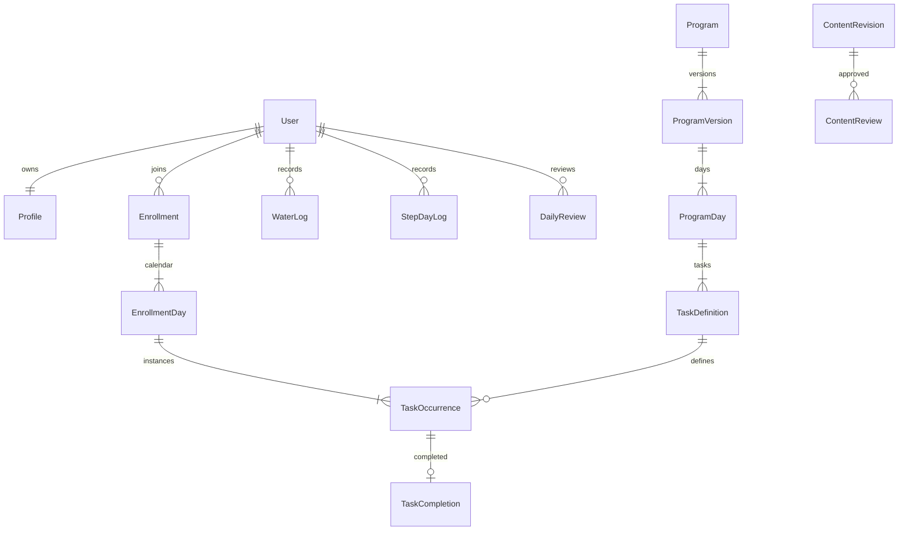

# تصميم PostgreSQL و Prisma

1.0 — 2026-10-11. **قاموس وتصميم منطقي فقط؛ لم تنشأ قاعدة أو schema.prisma أو migration.** [قواعد BR](PROJECT_REQUIREMENTS.md) و[ADR](SYSTEM_ARCHITECTURE.md) ملزمان. الأسماء المقترحة PascalCase لنماذج Prisma و snake_case في PostgreSQL. UUID معرفات، timestamptz للأحداث UTC ، date للأيام المحلية، time للوقت المجدول، numeric للكميات لا float. createdAt/updatedAt لكل كيان قابل للتعديل و revision integer optimistic lock ؛ nullable موضح بـ?؛ حقول أخرى واجبة. كل FK يملك index. النصوص محدودة في API و CHECK عند الحاجة.

## قاموس الحسابات والهوية

| النموذج | الحقول الأساسية والأنواع | المفاتيح/العلاقات/القيود |
|---|---|---|
| User | id UUID ، emailNormalized varchar254 ، passwordHash text ، role USER/COACH/ADMIN ، status PENDING/ACTIVE/SUSPENDED/DELETION_PENDING/DELETED ، verifiedAt?، createdAt | unique emailNormalized ، لا role في self update ؛ تعطيل يبطل sessions |
| Profile | userId UUID ، displayName varchar80 ، timezone varchar64 ، locale varchar10 ، cupMl? integer | PK/FK userId→User ؛ IANA validate ؛ cupMl>0 إن وجد؛ لا بيانات تشخيص مطلوبة |
| Session | id ، userId ، tokenHash ، expiresAt ، lastSeenAt ، revokedAt?، reauthenticatedAt?، mfaVerifiedAt? | unique tokenHash ، index userId/expiresAt ؛ token الأصلي لا يخزن |
| AuthToken | id ، userId ، kind VERIFY/RESET ، tokenHash ، expiresAt ، usedAt? | unique tokenHash ؛ استهلاك ذري؛ max active token policy |
| MfaCredential | userId ، secretEncrypted ، enabledAt?، recoveryHashes json | FKUser unique ؛ secret مشفر؛ رموز استعادة hashed أحادية |
| Consent | id ، userId ، kind PRIVACY/NOTIFICATIONS/COACH ، policyVersion ، scope json ، grantedAt ، revokedAt? | append history ؛ partial unique(userId,kind,scopeKey) حيث revokedAt null ، scopeKey text غير nullable |
| CoachAssignment | id ، coachId ، userId ، consentId ، scope enum[]، startsAt ، expiresAt ، revokedAt? | coach≠user ؛ FK ؛ composite consent ownership(userId,consentId)؛ صلاحية الدور/الموافقة داخل service/RLS |
| ReviewerQualification | id ، reviewerId ، scope ، evidenceReference ، verifiedBy ، validUntil ، status | verifier≠reviewer ؛ سجلات تأهيل حساسة للإدارة المخولة؛ لا أرفاق بيانات صحة |
| UserGoal | id ، userId ، metric WATER_ML/STEPS/EXERCISE_MIN/SLEEP_MIN ، value numeric12,2 ، effectiveDate ، endDate? | value>0 ، unique user/metric/effectiveDate ؛ service/قيد exclusion يمنع تداخل الفترات لكل metric |

## المصدر والمحتوى والبرامج

| النموذج | الحقول | العلاقات والقيود |
|---|---|---|
| SourceImage | id ، sourceKey IMG-*، path ، sha256 ، rightsStatus UNKNOWN/APPROVED | unique sourceKey/path ، الملفات الأصلية في references لا health uploads |
| SourceExtract | id ، imageId ، extractKey ، originalText ، section ، confidence HIGH/MEDIUM/LOW ، requiresReview bool | unique imageId/extractKey ؛ original immutable ؛ DIF روابط عبر SourceConflict |
| SourceConflict | id ، conflictKey DIF-*، description ، resolution?، resolvedBy? | source extracts متعدد عبر ConflictExtract ؛ لا يختفي الأصل عند الحسم |
| ContentRevision | id ، contentKey ، version ، kind MEAL/GUIDANCE/MOTIVATION/CLAIM ، title ، bodyText ، contentHash ، status DRAFT/IN_REVIEW/APPROVED/REJECTED/WITHDRAWN ، authorId | unique contentKey/version ؛ روابط المصدر ContentSource ؛ أي تحرير ينشئ revision جديدة بعد الاعتماد |
| ContentReview | id ، revisionId ، reviewerId ، qualificationId ، decision ، rationale ، decidedAt ، reviewedHash | review immutable ؛ reviewer≠author ؛ hash match ونطاق/تأهيل نافذ عند القرار |
| Program | id ، slug ، type LIFESTYLE/WALKING/CUSTOM ، status ACTIVE/PAUSED/ARCHIVED ، ownerId | unique slug ؛ تعطيل يمنع join لا يحذف history |
| ProgramVersion | id ، programId ، version ، title ، descriptionRevisionId ، durationDays integer ، startMode FLEXIBLE/FIXED ، fixedStartDate?، reviewSchemaVersionId ، policyVersionId ، status DRAFT/IN_REVIEW/PUBLISHED/WITHDRAWN ، publishedAt? | unique program/version ؛ duration1..366 حد منتج مقترح، لا حد 15 ؛ immutable بعد publish ؛ fixedStart شرط startMode |
| PolicyVersion | id ، version ، lateWindowDays ، dayBoundary ، streakRule ، certificateThreshold numeric5,2 | unique version ؛ lateWindow0..7 مقترح، boundary00:00 في v1 ، threshold0..100 ؛ جميع المشاركات مرتبطة |
| ProgramDay | id ، versionId ، dayIndex integer ، label? | unique version/dayIndex ؛ service يضمن مجموعة 1..duration دون فجوات |
| TaskDefinition | id ، programDayId ، key ، titleRevisionId ، type MEAL/WATER/STEPS/EXERCISE/SLEEP/HABIT/MANUAL ، required bool ، order integer ، scheduleKind NONE/AT/WINDOW/RELATIVE ، timeStart?، timeEnd?، anchorTaskId?، offsetMin?، completionMode MANUAL/THRESHOLD ، metric?، defaultTarget? numeric ، planMealId? | unique day/key و day/order ؛ CHECK حقول schedule تتسق و target>0 ؛ anchor نفس day ولا cycles ؛ سلامة روابط المحتوى عند publish |
| RecurrenceDefinition | id ، versionId ، taskTemplate jsonValidated ، dayIndices integer[] أو pattern EVERY_DAY/WEEKDAYS ، order | يستخدم المؤلف لتوسيع TaskDefinition عند publish ؛ لا توليد Runtime غامض؛ expanded definitions مصدر التنفيذ |
| NutritionPlan | id ، contentRevisionId ، label | خطة مرتبطة revision ؛ لا published mutable |
| PlanMeal | id ، planId ، dayIndex ، slot ، order ، mealRevisionId | unique plan/day/slot/order ؛ version محددة لكل link |
| Meal | id ، contentRevisionId ، slot enum BREAKFAST/LUNCH/DINNER/SNACK/OTHER | FK unique revisionId |
| Ingredient | id ، name ، unitFamily MASS/VOLUME/COUNT ، metadataRevisionId? | لا nutrition claims بلا review |
| MealIngredient | id ، mealId ، ingredientId ، quantity numeric10,2 ، unit enum G/ML/PIECE/SPOON/HANDFUL ، measurementBasis RAW/COOKED/UNSPECIFIED ، preparation?، conversionFactor? | quantity>0 ؛ UNSPECIFIED يمنع نشر حصة تتطلب دقة؛ لا تحويل ملعقة/قبضةيد تلقائيًا |
| MealAlternative | id ، planMealId ، alternativeMealId ، order ، approvalRevisionId | unique planMeal/alternativeMeal ؛ لا self reference ؛ كلبديل approved عند publish |
| ReviewSchemaVersion | id ، version ، name | unique version/name ؛ Published immutable |
| ReviewDimension | id ، schemaId ، key COMMITMENT/ENERGY/HUNGER/MOOD/GENERAL ، label ، order | unique schema/key ؛ اختيارية |
| ReviewOption | id ، dimensionId ، value integer ، label | unique dimension/value ؛ يحفظ label ترتيبًا لايستنتج good/bad |

التكرار أداة تأليف؛ النسخة المنشورة تحتوي ProgramDay و TaskDefinition موسّعين لجميع الأيام. مدة 367+ تحتاج تغيير حد منتج موثق، ليست حدًا تقنيًا لقاعدة DB. Published links لا تتغير؛ withdrawal حالة عرضسلامة وليست تعديلًا لمحتوى past. عدم وجود conversionFactor لا يمنع حفظ النص المرجعي لكنه يمنع استعماله كقياس رقمي دقيق حتى الاعتماد.

## المشاركة والسجلات الصحية

| النموذج | الحقول | قيود وملكية |
|---|---|---|
| Enrollment | id ، userId ، programId ، versionId ، policyVersionId ، startDate date ، timezoneSnapshot ، status SCHEDULED/ACTIVE/COMPLETED/WITHDRAWN ، withdrawnAt? | FK composite(programId,versionId) إلى ProgramVersion ؛ partial unique(userId,programId) WHERE active/scheduled ؛ unique(userId,id) لدعم FK ملكيات |
| EnrollmentDay | id ، userId ، enrollmentId ، localDate ، dayIndex ، state OPEN/LOCKED/EXCLUDED ، exclusionReason? | unique enrollment/dayIndex و enrollment/date ؛ composite FK(userId,enrollmentId)؛ FK إلى ProgramDay الصحيحة عبر service والتحقق |
| TaskOccurrence | id ، userId ، dayId ، definitionId ، scheduledAt?، dueAt?، requiredSnapshot ، targetSnapshot?، metric?، orderSnapshot | unique(dayId,definitionId) و unique(userId,id)؛ composite ownerFK إلى EnrollmentDay ؛ requiredSnapshot ثابت؛ exclusions فيسجل منفصل لا حذف |
| TaskCompletion | occurrenceId ، userId ، completedAt ، recordedAt ، isLate ، mode MANUAL/DERIVED ، evidenceRevision | PKoccurrenceId و FK(userId,occurrenceId)؛ derived لا write من USER ؛ لا counts متعددة |
| TaskExclusion | id ، occurrenceId ، reason ، authorizedBy ، effectiveAt ، sourceWithdrawalId? | unique occurrenceId ؛ استثناء audited ، لا optional conversion صامت |
| MealSelection | id ، userId ، occurrenceId ، planMealId ، alternativeMealId? | unique occurrenceId ؛ بديل فقط من sameplan وإصدار؛ لا المهمة الثانية |
| WaterLog | id ، userId ، occurredAt ، recordedAt ، localDate ، timezoneSnapshot ، amountMl integer ، inputUnit ML/CUP ، cupMlSnapshot?، deletedAt? | amountMl>0 ؛ cup snapshot واجبإن CUP ؛ aggregate undeleted فقط؛ revision للتصحيح |
| StepDayLog | id ، userId ، localDate ، timezoneSnapshot ، totalSteps integer ، recordedAt ، source MANUAL | unique(userId,localDate)، totalSteps≥0 ؛ snapshot replacement ؛ history عبر LogRevision |
| ExerciseLog | id ، userId ، type ، startsAt ، durationMin integer ، localDate ، note?، deletedAt? | duration1..1440 ؛ نوع allowlist ؛ ownershipRLS |
| SleepLog | id ، userId ، startsAt ، endsAt ، wakeDate ، timezoneSnapshot ، deletedAt? | ends>starts ، مدة≤24h حدإدخالمنتج لاوصفة؛ exclusion overlap active logs لكل user (GiST+tstzrange) |
| HabitDefinition | id ، userId ، title varchar120 ، recurrence ، startsDate ، endsDate?، archivedAt? | شخصية؛ program habit محفوظ TaskDefinition لا نسخها كإتمام شخصي |
| HabitLog | id ، userId ، habitId ، localDate ، completedAt | unique(habitId,localDate)، composite ownerFK |
| DailyReview | id ، userId ، localDate ، schemaVersionId ، notes? text ، weightKg? numeric5,2 ، recordedAt | unique(userId,localDate)؛ وزن>0 إن وجد؛لافرضوزن؛ تقييم schema ما زال نافذًا للتحرير |
| ReviewAnswer | reviewId ، dimensionId ، optionId | PKreview/dimension ؛ compositeFKoption+dimension ، validate dimension belongs review.schema ؛ لاقيم حرة خارج options |
| CorrectionRequest | id ، userId ، targetKind ، targetId ، proposedPatch encryptedJson ، reason ، status PENDING/APPROVED/REJECTED/CANCELLED ، reviewedBy?، reviewedAt? | فحص target ملك user ؛ polymorphicFK يعالج service مع registry ؛ لا generic arbitraryJSONpatch |
| LogRevision | id ، userId ، targetKind ، targetId ، revision ، beforeEncrypted?، afterEncrypted?، cause ، recordedAt | unique target/revision ؛ RLS نفس owner ، محدد الاحتفاظ A08 ؛ ليس operationalaudit عامًا |
| CoachNote | id ، coachId ، userId ، assignmentId ، text ، createdAt | scope note وموافقة؛ user يرىالملاحظة؛ لا تعديل Review الأصلي |

كل فئة metric شخصية تملك userId غير nullable وفهارس(userId,localDate) أو(userId,wakeDate)، فهارس deletedAt partial للسجلات الفعالة. لا يقبل serveruserId للملكية من payload. أسماء الحقول اللاتينية هي معيار التنفيذ.

## الإنجاز والتنبيهات والتشغيل

| النموذج | الحقول والقيود |
|---|---|
| AchievementRuleVersion | id ، code ، version ، type FIRST_DAY/STREAK/COMPLETION ، config validatedJson ، contentRevisionId ؛ unique code/version ، immutable published |
| ProgramAchievementRule | versionId/ruleVersionId مركب؛ قواعد مرتبطة بالبرنامج |
| AchievementAward | id ، userId ، enrollmentId ، ruleVersionId ، status GRANTED/REVOKED ، grantedAt ، revokedAt?، evidence json ، aggregateRevision ؛ unique user/enrollment/ruleVersion ؛ regrant بحالةوتاريخ/سجلتدقيقلا duplicate |
| Certificate | id ، awardId unique ، serial unique ، issuedAt ، status VALID/REVOKED ؛ معاينةخاصة، لا PDF خارجي أو تخزين عام |
| NotificationPreference | userId PK ، enabledInApp ، enabledPush ، quietStart?، quietEnd?، timezone ، consentId?؛ push يستلزم consent |
| ReminderRule | id ، userId ، enrollmentId?، taskDefinitionId?، localTime ، channel ، enabled ؛ لا rule دون owner/permission |
| PushSubscription | id ، userId ، endpointHash unique ، endpointEncrypted ، keysEncrypted ، revokedAt? |
| Notification | id ، userId ، type ، safeTitle ، safeBody ، targetKind ، targetId ، readAt?، dedupeKey ؛ unique(userId,dedupeKey) |
| OutboxJob | id ، kind EMAIL/PUSH/EXPORT/DELETE/RECALCULATE ، userId?، payloadEncrypted ، dueAt ، leaseUntil?، attempts ، status PENDING/RUNNING/DONE/FAILED/CANCELLED ، dedupeKey unique ، lastErrorCode?؛ index status/dueAt |
| IdempotencyRecord | actorId/action/key PK مركب، requestHash ، responseEncrypted ، expiresAt ؛ ownerscope ، لاحفظ secrets |
| RateLimitBucket | keyHash/window PK ، count ، expiresAt ؛ shared atomicincrement ، purgeTTL |
| AuditLog | id ، actorId?، action ، targetType ، targetId?، requestId ، occurredAt ، reason?، safeMetadata ؛ appendonly ، لا password/token/نصصحي |
| PrivacyRequest | id ، userId ، kind EXPORT/DELETE ، status ، requestedAt ، completedAt?، expiresAt?، resultLocationEncrypted?؛ unique فعال user/kind عبر partialindex |
| DeletionLedger | subjectKeyHash ، completedAt ، retainUntil ، backupCutoff ؛ لا health ، مستقل لمعالجة استعادة نسخ قديمة |
| OperationsReport | id ، kind BACKUP/RESTORE/RESOURCE/INCIDENT ، safeMetadata ، performedBy ، occurredAt ؛ لا تخزن dump في DB |

## العلاقات والقيود العابرة للجداول

Prisma يولد Models و FK/unique المعروفة؛ CHECK و partialindexes و RLS و triggers/exclusion تنفذ SQLmigrations مراجعة لاحقًا، لا يفترض Prisma يعبر عن كل القيود. trigger يحظر UPDATE/DELETE للحقول المحتوية نسخة PUBLISHED وروابطها، ويجيز فقط transitionWITHDRAWN المحدد؛ منع publishedapprovalhashmismatch في publish transaction ؛ قيد consistencydayIndex/duration في service مع integrationtest لأن CHECK لا يقارن جدولًا آخر. قيد compositeownership يحظر إسناد TaskCompletion لسجل غير المستخدم حتى إذا فشل ال service.

FK ON DELETE RESTRICT لمراجع البرامج المستخدمة/المراجعات/ال audit ؛ ON DELETE CASCADE لبيانات شخصية مملوكة عند job حذف معتمد وفق ترتيب، وليس زر مدير عام. User tombstone لا يحفظ email/hash بعد إنهاء الحذف؛ auditactorIdnullable/pseudonymized مع سبب؛ لا يحذف programauthored عند حذف author بل تفصل هوية الشخص بعد مراجعة الاحتفاظ. لا harddelete سجل بطريقة تخفي تصحيحًا قبل النافذة/التدقيق؛ softdelete ثم purge وفق سياسة. لا تعني أرشفة مرجع معتمد حذف ملف صورة.

## بروتوكولات الحفظ والاسترجاع

الانضمام: lockprogram→تحقق PUBLISHED وأهداف→Enrollment+days+occurrences+snapshots→audit→commit ؛ retryidempotent. إضافة ماء: تحقق وقت وملكية→WaterLog→إعادة derivedcompletion لقواعد اليوم/كل enrollment نفس المستخدم→awardrecalcjob→audit→commit. تحديث خطوات: lockuniqueuser/date→If-Match→replace→نفس إعادة الحساب. مراجعة: upsertuniqueuser/date مع schema ثابت و options مخولة. نشر: فحص فجوات الأيام والأوقات والبدائل ومراجع المحتوى→تثبيت نسخة→audit. استرجاع today: actor/date/timezone→logs+occurrences+derivedcounts→DTO ؛ لا sum قيمة من الواجهة.

التصدير JSON/CSV يشمل profile/goals/enrollments/logs/reviews/consents/awards ، لا secrets/sessionhash/بيانات غيره؛ توليد stream محدود أو job ، TTL رابط 15 دقيقة مقترح، تنزيل sessionboundno-store. deletionjob يغلق الحساب ويبطل جلسات وتعيينات/push ثم يمحو البيانات الشخصية وال exports ويكتب ledger ؛ المحتوى المؤلف وال audit يطبق عليهما سياسة legalA08. orphancheck بعد الحذف.

## خطة اختبار قاعدة البيانات

T-03 RLS مع appnonowner ومستخدمين وتبديل pool/coachrevocation ؛ T-05joinduplicate بالتزامن؛ T-06completionduplicate ؛ T-08waterreplay/delete ؛ T-09stepssnapshot ؛ T-10sleepexclusion وعبور اليوم؛ T-11option من schema آخر؛ T-12 مقام صفر واختياري وهدف صفر؛ T-17 نشر غير مراجع/hashchanged ؛ T-18restoreFks/counts/isolation ؛ T-16export/delete/ledger. المقاييس والاختبارات مستقبلية ولم تنفذ الآن.
