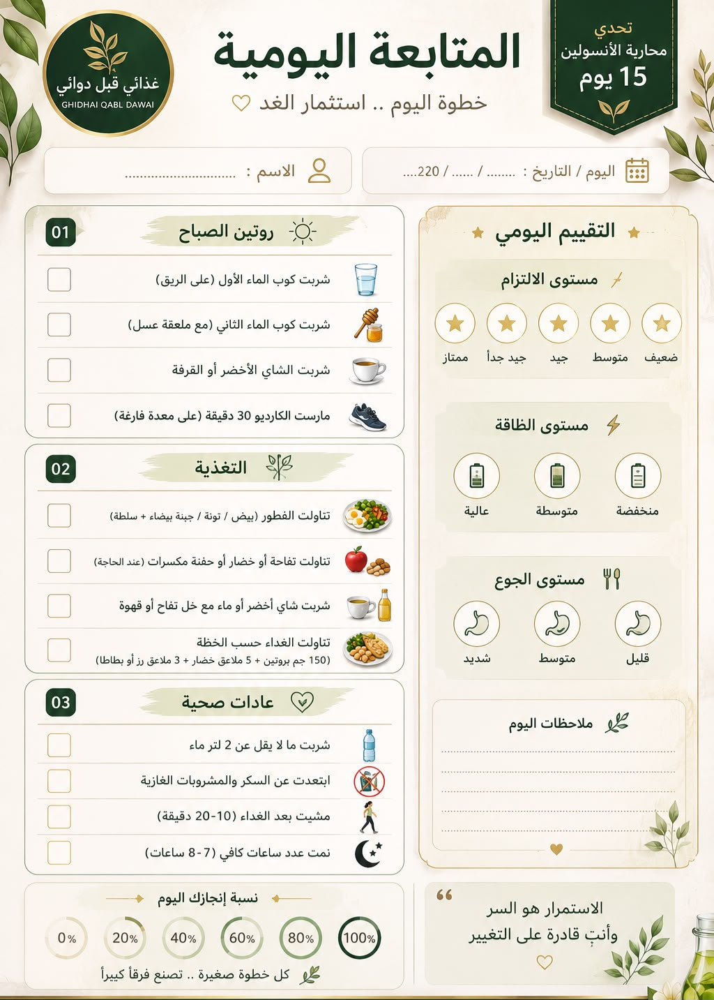
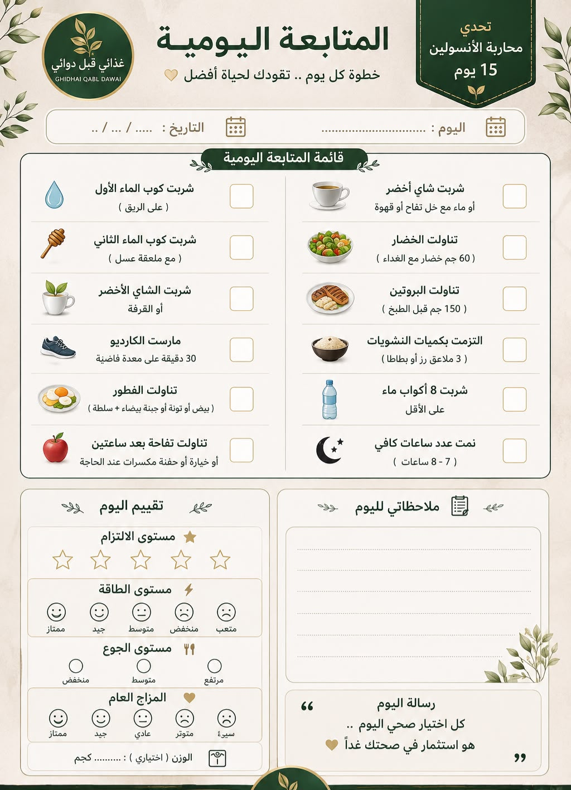
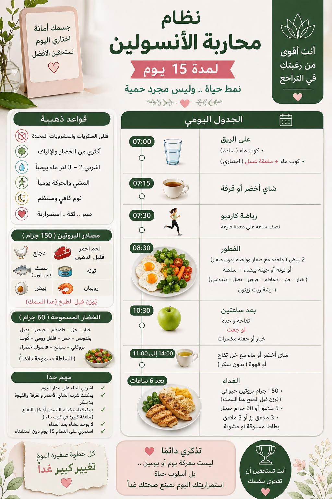
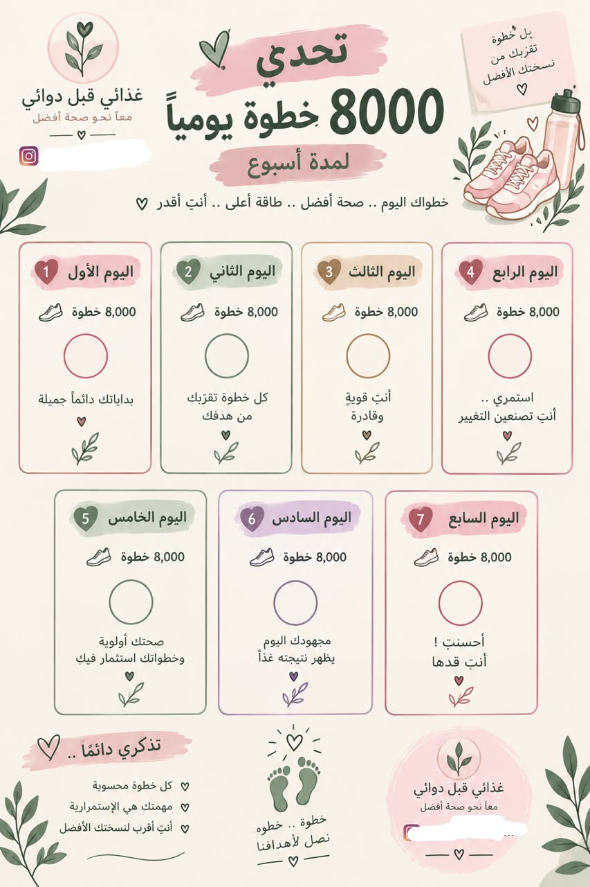
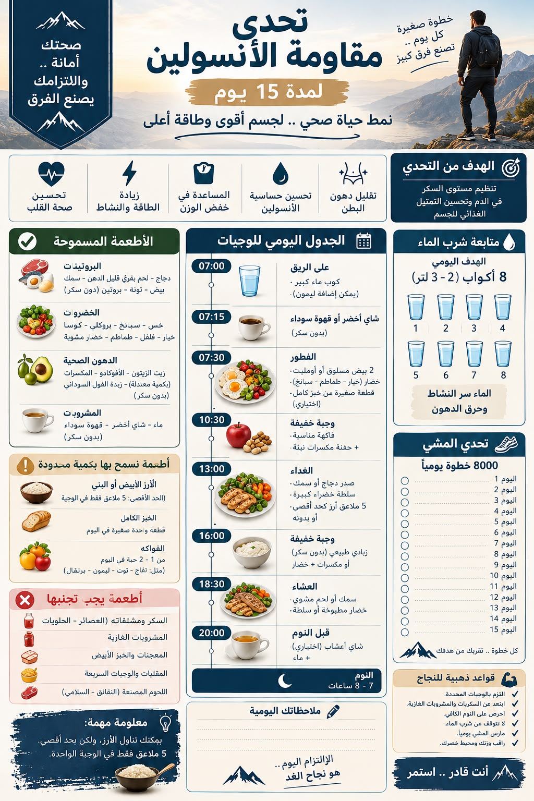
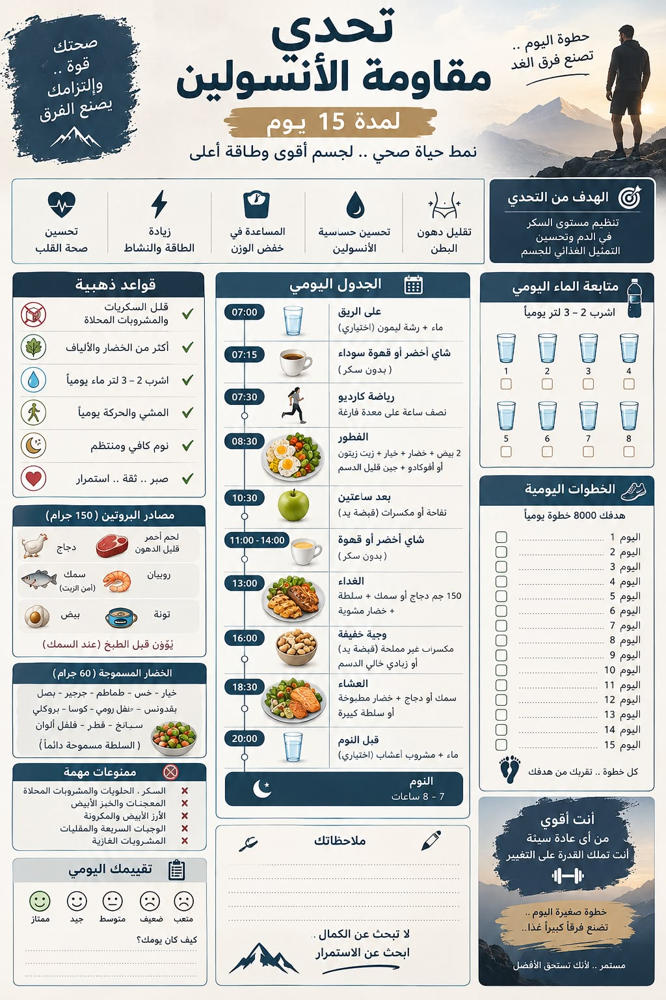

# تحليل الصور المرجعية

الإصدار 1.0 — 2026-10-11. المصدر: [تعليمات المشروع](../AGENTS.md) وتكليف التصميم. فُحصت الصور الست بصريًا مباشرة، وليس اعتمادًا على أسماء الملفات. جميع الكميات والأوقات والادعاءات أدناه **نقل مرجعي غير معتمد صحيًا**. لا توجد بيانات مرضى في الصور. النصوص الصغيرة المقروءة مدونة؛ الأجزاء المطموسة غير قابلة للاسترجاع ولا تُستنتج.

## IMG-01 — reference-01.jpg

الهوية: «غذائي قبل دوائي»، GHIDHAI QABL DAWAI ، «المتابعة اليومية»، «خطوة اليوم .. استثمار الغد»، «تحدي محاربة الأنسولين 15 يوم». حقلا الاسم واليوم/التاريخ؛ نموذج تاريخ مطبوع غير مكتمل، لا يمثل سنة فعلية.

| القسم | النص والمهام المستخرجة |
|---|---|
| روتين الصباح 01 | شربت كوب الماء الأول (على الريق)؛ شربت كوب الماء الثاني (مع ملعقة عسل)؛ شربت الشاي الأخضر أو القرفة؛ مارست الكارديو 30 دقيقة (على معدة فارغة) |
| التغذية 02 | تناولت الفطور (بيض / تونة / جبنة بيضاء + سلطة)؛ تناولت تفاحة أو خضار أو حفنة مكسرات (عند الحاجة)؛ شربت شاي أخضر أو ماء مع خل تفاح أو قهوة؛ تناولت الغداء حسب الخطة (150 جم بروتين + 5 ملاعق خضار + 3 ملاعق رز أو بطاطا) |
| عادات صحية 03 | شربت ما لا يقل عن 2 لتر ماء؛ ابتعدت عن السكر والمشروبات الغازية؛ مشيت بعد الغداء (10–20 دقيقة)؛ نمت عدد ساعات كافي (7–8 ساعات) |
| التقييم | الالتزام: ضعيف، متوسط، جيد، جيد جدًا، ممتاز (خمسة مستويات)؛ الطاقة: منخفضة، متوسطة، عالية؛ الجوع: قليل، متوسط، شديد |
| الإنجاز | دوائر 0%، 20%، 40%، 60%، 80%، 100% دون معادلة حساب أو أوزان |
| الملاحظات والتحفيز | ملاحظات اليوم؛ «الاستمرار هو السر وأنت قادرة على التغيير»؛ «كل خطوة صغيرة .. تصنع فرقًا كبيرًا» |

اثنتا عشرة خانة إتمام؛ المشي بعد الغداء موجود هنا فقط. لم يرد توقيت ساعة ولا عشاء ولا مزاج أو وزن. الخطاب مؤنث. الأخضر والذهبي والخلفية الكريمية والورق النباتي أساس بصري.

## IMG-02 — reference-02.jpg

«المتابعة اليومية»، «خطوة كل يوم .. تقودك لحياة أفضل»، «تحدي محاربة الأنسولين 15 يوم». حقلا اليوم والتاريخ؛ الاسم غير موجود.

| قائمة المتابعة اليومية | التفاصيل |
|---|---|
| الماء الأول والثاني | على الريق؛ مع ملعقة عسل |
| مشروب الصباح | الشاي الأخضر أو القرفة |
| الكارديو | 30 دقيقة على معدة فاضية |
| الفطور | بيض أو تونة أو جبنة بيضاء + سلطة |
| بعد ساعتين | تفاحة أو خيارة أو حفنة مكسرات عند الحاجة |
| مشروب لاحق | شاي أخضر أو ماء مع خل تفاح أو قهوة |
| الغداء المفصل | خضار 60 جم مع الغداء؛ بروتين 150 جم قبل الطبخ؛ النشويات 3 ملاعق رز أو بطاطا (ثلاث خانات منفصلة) |
| الماء والنوم | 8 أكواب ماء على الأقل؛ 7–8 ساعات نوم |

12 خانة. تقييم اليوم: الالتزام خمس نجوم بلا تسميات؛ الطاقة خمسة مستويات «ممتاز، جيد، متوسط، منخفض، متعب»؛ الجوع «منخفض، متوسط، مرتفع»؛ المزاج العام «ممتاز، جيد، عادي، متوتر، سيئ»؛ الوزن اختياري بالكيلوجرام. «ملاحظاتي لليوم»، «رسالة اليوم: كل اختيار صحي اليوم .. هو استثمار في صحتك غدًا». لا مشي بعد الغداء ولا خانة مستقلة لتجنب السكر. اختلاف الطاقة مع IMG-01 لا يُسوّى بتغيير البيانات الأصلية.

## IMG-03 — reference-03.jpg

العنوان «نظام محاربة الأنسولين لمدة 15 يوم»، «نمط حياة .. وليس مجرد حمية». نصوص تحفيزية: «جسمك أمانة اختاري اليوم تستحقين الأفضل»؛ «أنت أقوى من رغبتك في التراجع»؛ «كل خطوة صغيرة اليوم تغيير كبير غدًا»؛ «تذكري دائمًا ليست معركة يوم أو يومين .. بل أسلوب حياة استمراريتك اليوم تصنع صحتك غدًا»؛ «أنت تستحقين أن تفخري بنفسك».

| الموعد كما طبع | النشاط / الوجبة |
|---|---|
| 07:00 | على الريق: كوب ماء سادة؛ كوب ماء + ملعقة عسل (اختياري) |
| 07:15 | شاي أخضر أو قرفة |
| 07:30 | رياضة كارديو نصف ساعة على معدة فارغة |
| 08:30 | الفطور: 2 بيض (واحدة مع صفار وواحدة بدون صفار)، أو تونة أو جبنة بيضاء + سلطة (خيار، جزر، طماطم، جرجير، بصل، بقدونس) + رشة زيت زيتون |
| 10:30 / بعد ساعتين | تفاحة واحدة؛ لو جعت: خيار أو حفنة مكسرات |
| 11:00 إلى 14:00 | شاي أخضر أو ماء مع خل تفاح أو قهوة (بدون سكر) |
| بعد 6 ساعات | الغداء: 150 جرام بروتين حيواني (يوزن قبل الطبخ عدا السمك)؛ 5 ملاعق أو 60 جرام خضار؛ 3 ملاعق رز أو 3 ملاعق بطاطا مسلوقة أو مشوية |

قواعد ذهبية: قللي السكريات والمشروبات المحلاة؛ أكثري الخضار والألياف؛ اشربي 2–3 لتر ماء يوميًا؛ المشي والحركة يوميًا؛ نوم كافٍ ومنتظم؛ صبر، ثقة، استمرارية.

مصادر البروتين (150 جرام): دجاج، لحم أحمر قليل الدهون، سمك (من الوزن)، تونة، بيض، روبيان. عبارة الوزن العامة «يوزن قبل الطبخ (عدا السمك)»؛ «من الوزن» تحت السمك غير محددة المعنى وتحتاج سؤال المصدر.

الخضار المسموحة (60 جرام): خيار، جزر، طماطم، جرجير، بصل، بقدونس، خس، فلفل رومي، كوسا، بروكلي، سبانخ، فاصوليا خضراء. «السلطة مسموحة دائمًا».

«مهم جدًا»: شرب الماء على مدار اليوم؛ الشاي الأخضر والقرفة والقهوة بلا سكر؛ يمكن استخدام الليمون أو خل التفاح (ملعقة كبيرة في كوب ماء)؛ **لا يوجد عشاء بعد الغداء**؛ الاستمرار 15 يومًا دون استثناء. كل هذه توجيهات تحتاج مراجعة، خاصة الامتناع عن العشاء والرياضة صائمًا والعسل/الخل. لا تقييم أو عداد خطوات في هذه الصورة.

## IMG-04 — reference-04.jpg

«غذائي قبل دوائي»، «معًا نحو صحة أفضل»، «تحدي 8000 خطوة يوميًا لمدة أسبوع». «خطواتك اليوم .. صحة أفضل .. طاقة أعلى .. أنت أقدر»؛ «بل خطوة تقربك من نسختك الأفضل». مقبضا Instagram في الأعلى والأسفل مطموسان، لا يمكن استخراجهما.

| اليوم | الهدف | رسالة اليوم |
|---|---|---|
| الأول 1 | 8,000 خطوة | بداياتك دائمًا جميلة |
| الثاني 2 | 8,000 خطوة | كل خطوة تقربك من هدفك |
| الثالث 3 | 8,000 خطوة | أنت قوية وقادرة |
| الرابع 4 | 8,000 خطوة | استمري .. أنت تصنعين التغيير |
| الخامس 5 | 8,000 خطوة | صحتك أولوية وخطواتك استثمار فيك |
| السادس 6 | 8,000 خطوة | مجهودك اليوم يظهر نتيجته غدًا |
| السابع 7 | 8,000 خطوة | أحسنت! أنت قدها |

دائرة متابعة لكل يوم لا تعرض خطوات فعلية. تذكير: «كل خطوة محسوبة»، «مهمتك هي الاستمرارية»، «أنت أقرب لنسختك الأفضل». «خطوة .. خطوة .. نصل لأهدافنا». ألوان وردية/خضراء/ذهبية وبنفسجية. لا وجبات ولا ماء كمي ولا نوم أو تقييم. لا دليل على تكامل أجهزة لعد الخطوات.

## IMG-05 — reference-05.jpg

«تحدي مقاومة الأنسولين لمدة 15 يوم»، «نمط حياة صحي .. لجسم أقوى وطاقة أعلى». الهدف المطبوع: تنظيم مستوى السكر في الدم وتحسين التمثيل الغذائي للجسم. فوائد مدعاة: تقليل دهون البطن، تحسين حساسية الأنسولين، المساعدة في خفض الوزن، زيادة الطاقة والنشاط، تحسين صحة القلب. **هذه ادعاءات مرجعية وليست نتائج مضمونة أو محتوى معتمد.**

| الساعة | محتوى الجدول |
|---|---|
| 07:00 | على الريق كوب ماء كبير (يمكن إضافة ليمون) |
| 07:15 | شاي أخضر أو قهوة سوداء بدون سكر |
| 07:30 | الفطور: 2 بيض مسلوق أو أومليت؛ خضار (خيار، طماطم، سبانخ)؛ قطعة صغيرة من خبز كامل اختياري |
| 10:30 | وجبة خفيفة: فاكهة مناسبة + حفنة مكسرات نيئة |
| 13:00 | الغداء: صدر دجاج أو سمك؛ سلطة خضراء كبيرة؛ 5 ملاعق أرز كحد أقصى أو بدونه |
| 16:00 | وجبة خفيفة: زبادي طبيعي بدون سكر أو مكسرات + خضار |
| 18:30 | العشاء: سمك أو دجاج مشوي؛ خضار مطبوخة أو سلطة |
| 20:00 | قبل النوم: شاي أعشاب اختياري + ماء |
| النوم | 7–8 ساعات |

الأطعمة المسموحة: بروتينات (دجاج، لحم بقري قليل الدهن، سمك، بيض، تونة، بروتين دون سكر)؛ خضروات (خس، سبانخ، بروكلي، كوسا، خيار، فلفل، طماطم، خضار مشوية)؛ دهون صحية (زيت الزيتون، الأفوكادو، المكسرات بكمية معتدلة، زبدة الفول السوداني بدون سكر)؛ مشروبات (ماء، شاي أخضر، قهوة سوداء بدون سكر).

مسموح بكمية محدودة: الأرز الأبيض أو البني، الحد الأقصى 5 ملاعق فقط في الوجبة؛ الخبز الكامل قطعة واحدة صغيرة في اليوم؛ الفواكه 1–2 حبة في اليوم (تفاح، توت، ليمون، برتقال). يجب تجنب: السكر ومشتقاته (العصائر، الحلويات)، المشروبات الغازية، المعجنات والخبز الأبيض، المقليات والوجبات السريعة، اللحوم المصنعة (النقانق، السلامي). مربع معلومة مهمة يكرر حد الأرز 5 ملاعق في الوجبة.

الماء: الهدف اليومي «8 أكواب (2–3 لتر)»، أكواب مرقمة 1–8 ؛ «الماء سر النشاط وحرق الدهون» ادعاء يحتاج مراجعة. المشي: 8000 خطوة يوميًا مع خانات اليوم 1 إلى 15 ؛ «كل خطوة .. تقربك من هدفك». قواعد النجاح: الوجبات المحددة، الابتعاد عن السكريات والغازية، النوم الكافي، عدم التوقف عن شرب الماء، المشي يوميًا، مراقبة الوزن ومحيط الخصر. ملاحظات يومية دون مقياس تقييم. تحفيز: «صحتك أمانة .. والتزامك يصنع الفرق»، «خطوة صغيرة كل يوم .. تصنع فرق كبير»، «الالتزام اليوم .. هو نجاح الغد»، «أنت قادر .. استمر».

## IMG-06 — reference-06.jpg

العنوان والمدة والفوائد والهدف مثل IMG-05. «صحتك قوة .. والتزامك يصنع الفرق»، «خطوة اليوم .. تصنع فرق الغد».

| الساعة | محتوى الجدول |
|---|---|
| 07:00 | ماء + رشة ليمون اختياري على الريق |
| 07:15 | شاي أخضر أو قهوة سوداء بدون سكر |
| 07:30 | رياضة كارديو نصف ساعة على معدة فارغة |
| 08:30 | الفطور: 2 بيض + خضار + خيار + زيت زيتون أو أفوكادو + جبن قليل الدسم |
| 10:30 / بعد ساعتين | تفاحة أو مكسرات (قبضة يد) |
| 11:00–14:00 | شاي أخضر أو قهوة بدون سكر |
| 13:00 | الغداء: 150 جم دجاج أو سمك + سلطة + خضار مشوية |
| 16:00 | وجبة خفيفة: مكسرات غير مملحة (قبضة يد) أو زبادي خالي الدسم |
| 18:30 | العشاء: سمك أو دجاج + خضار مطبوخة أو سلطة كبيرة |
| 20:00 | ماء + مشروب أعشاب اختياري قبل النوم |
| النوم | 7–8 ساعات |

القواعد الذهبية: تقليل السكر والمحلاة؛ الإكثار من الخضار والألياف؛ ماء 2–3 لتر؛ المشي والحركة يوميًا؛ نوم كافٍ ومنتظم؛ صبر، ثقة، استمرار.

مصادر البروتين (150 جرام): دجاج، لحم أحمر قليل الدهون، سمك (من الوزن)، روبيان، بيض، تونة (من الزيت). عبارة «يوزن قبل الطبخ (عدا السمك)»؛ عبارتا السمك والتونة كما تظهران لا تُفسران تلقائيًا.

الخضار المسموحة (60 جرام): خيار، خس، طماطم، جرجير، بصل، بقدونس، فلفل رومي، كوسا، بروكلي، سبانخ، فطر، فلفل ألوان. السلطة مسموحة دائمًا.

ممنوعات مهمة: السكر، الحلويات والمشروبات المحلاة؛ المعجنات والخبز الأبيض؛ الأرز الأبيض والمعكرونة؛ الوجبات السريعة والمقليات؛ المشروبات الغازية. الماء: 2–3 لتر يوميًا مع ثمانية أكواب مرقمة وخانات إتمام. الخطوات اليومية: هدف 8000 مع 15 خانة يوم. التقييم اليومي: ممتاز، جيد، متوسط، ضعيف، متعب؛ «كيف كان يومك؟» حقل نص. «ملاحظاتك» حقل مستقل؛ «لا تبحث عن الكمال .. ابحث عن الاستمرار». «أنت أقوى من أي عادة سيئة أنت تملك القدرة على التغيير»، «خطوة صغيرة اليوم .. تصنع فرقًا كبيرًا غدًا»، «مستمر .. لأنك تستحق الأفضل».

## سجل الاختلافات والتعارضات

| ID | المصادر | الاختلاف | قرار التصميم |
|---|---|---|---|
| DIF-01 | 01–03 / 05–06 | محاربة الأنسولين / مقاومة الأنسولين | حفظ الاسم الأصلي في المصدر؛ اسم البرنامج العام غير العلاجي مقترح حتى اعتماد المختص |
| DIF-02 | 03 / 05–06 | لا عشاء / عشاء 18:30 | نسخ مستقلة؛ لا خلط في خطة واحدة؛ حجب النشر حتى الحسم |
| DIF-03 | 01–03 / 05 / 06 | 3 ملاعق رز / حتى 5 / منع الأرز الأبيض | لا اختيار تلقائي؛ بدائل وحصص مرتبطة بنسخة ومراجعة |
| DIF-04 | 01 / 02 / 03,05,06 | ≥2 لتر / ≥8 أكواب / 2–3 لتر | ml وحدة التخزين؛ حجم الكوب غير موجود ولا يساوي افتراضيًا لترًا محددًا |
| DIF-05 | 01–03 / 05–06 | ماء بعسل / ليمون أو سادة | العسل اختياري في 03 وغير موصوف كذلك في 01–02 ؛ يحتاج مراجعة |
| DIF-06 | 03,06 / 05 | كارديو 07:30 وفطور 08:30 / فطور 07:30 | محرك مهام قابل للتهيئة، لا توقيت موحد |
| DIF-07 | 03 / 05–06 | غداء بعد 6 ساعات / 13:00 | أساس الـ 6 ساعات غير مصرح به؛ لا تحويل إلى ساعة افتراضية |
| DIF-08 | 04 / 05–06 | مشي 7 أيام / 15 يومًا | قالبا مشي مستقلان؛ 8000 قيمة مرجعية قابلة للتخصيص |
| DIF-09 | 01 / 02 / 06 | طاقة ثلاثية / خماسية / تقييم عام خماسي | حفظ اسم البعد ونسخة المقياس؛ لا مقارنة بين أبعاد مختلفة |
| DIF-10 | 01 / 02 | جوع قليل–شديد / منخفض–مرتفع | توحيد مقترح للعرض فقط بعد اعتماد؛ الأصل محفوظ |
| DIF-11 | 01 / 02,06 | لا مزاج/وزن / مزاج ووزن في 02 ، تقييم عام في 06 | حقول اختيارية لا شروط لإتمام اليوم |
| DIF-12 | 03 / 06 | جزر وفاصوليا / فطر وفلفل ألوان | قوائم النسخ منفصلة |
| DIF-13 | 03 / 05 / 06 | لا وجبة 16:00 / زبادي طبيعي / خالي الدسم | لا جمع بين الخطط |
| DIF-14 | 03 / 06 | بيضة بصفار وأخرى دونه / بيضتان دون تفصيل | يحتاج حسم المختص |
| DIF-15 | 05 / 06 | فواكه 1–2 وخبز كامل / لا نص مطابق | غياب النص ليس منعًا |
| DIF-16 | 01 / 02 | غداء خانة واحدة / ثلاث خانات | تعريف المهام يحدد مقام الإنجاز؛ الأعداد ليست أوزانًا صحية |
| DIF-17 | 01–06 | مؤنث/مذكر، أخضر/وردي/أزرق، توقيت/قائمة | لغة عربية محايدة وتصميم موحد؛ حفظ الرسائل الأصلية للاعتماد |

## فجوات المصدر وحوكمة المحتوى

G-01 حجم الكوب والملعقة غير محدد؛ G-02 وزن السمك وعبارة التونة غير واضحين؛ G-03 لا توصيف لمناسبة الخطة للحالات الصحية أو العمر أو الأدوية؛ G-04 لا منهج لحساب الإنجاز أو منح الشهادات؛ G-05 لا تعريف لبداية اليوم/التأخر؛ G-06 لا حقوق استخدام للشعار والصور أو هوية الحسابات المطموسة؛ G-07 لا قياس لحجم حصة الفطور/الجبن/المكسرات بصورة موحدة؛ G-08 لا دليل للتكامل مع أجهزة؛ G-09 لا نموذج موافقة أو إشعارات أو صلاحيات في الصور.

يعتمد النظام سجل SourceImage + SourceExtract لكل صف/فقرة أعلاه، مع originalText و sourceKey و confidence و reviewStatus. مفاتيح IMG-01..06 و DIF-01..17 مراجع دائمة. يراجع مختص مؤهل الادعاءات والفوائد، العسل والخل، الرياضة على معدة فارغة، منع وجبات/أطعمة، الحصص والأهداف. أي تعديل يحفظ الأصل وسبب التعديل والمراجع وتاريخه. لا تتحول حالة المرجع إلى Published بمجرد استخراجه. المتطلبات الناتجة مرتبطة في [سجل التتبع](REQUIREMENTS-TRACEABILITY.md)، ومسار الاعتماد في [متطلبات المشروع](PROJECT_REQUIREMENTS.md).
