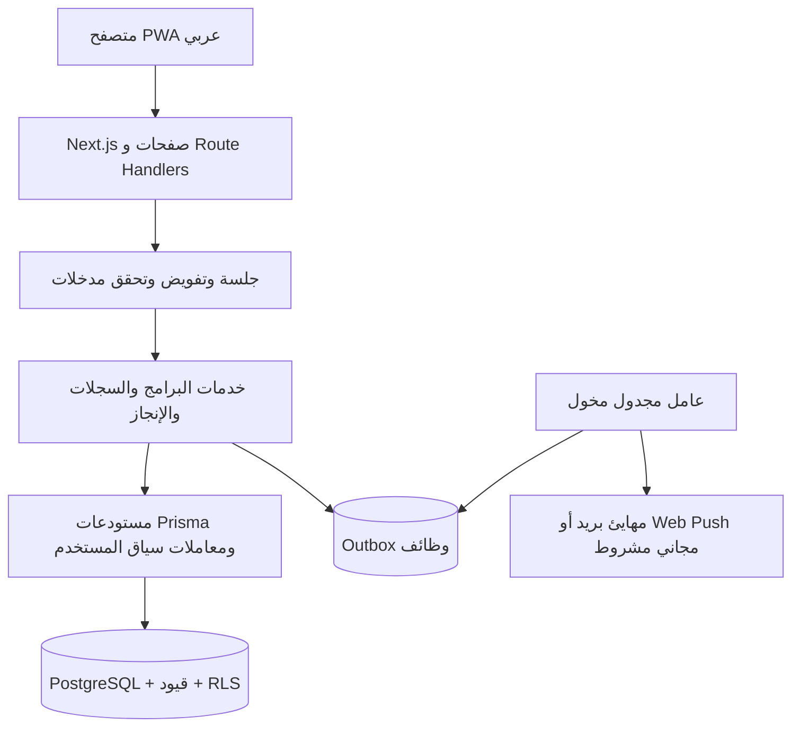

# معمارية النظام

1.0 — 2026-10-11. تصميم فقط، لا package.json أو migrations أو موارد سحابية في هذا التكليف. مصدر القرارات [المتطلبات](PROJECT_REQUIREMENTS.md)؛ تفاصيل [البيانات](DATABASE_DESIGN.md) و[العقود](API_SPECIFICATION.md).

## ADR-01: تطبيق موحد قابل للنقل

Next.js App Router + React + TypeScript strict + Tailwind ؛ PostgreSQL + Prisma. تثبيت إصدارات stable متوافقة و Node LTS و lockfile في مرحلة التنفيذ بعد تحقق وثائق الإصدارات؛ لا ادعاء أرقام إصدارات لم تثبت الآن. runtime خادمي Node للمصادقة/Prisma ، وليس Edge افتراضيًا. Server Components لقراءة الصفحة، Client Components للأزرار/النماذج/الرسوم عند الحاجة. لا microservices مطلوبة للحجم الأول.

حدود مستقبلية مقترحة: `src/app/(public)`، `(auth)`، `(participant)`، `(coach)`، `(admin)`، `src/app/api/v1`؛ `src/modules/{auth,programs,nutrition,tracking,reviews,analytics,notifications,privacy}`؛ `src/server/{authorization,db,audit,jobs}`؛ `src/components`؛ `prisma`؛ `tests/{unit,integration,e2e}`. المسارات مقترحة وليست ملفات موجودة. مكونات الواجهة لا تصل DB ؛ domain services مشتركة بين RSC و Route Handler ؛ لا التفاف داخلي عبر HTTP بلا حاجة. middleware لتحسين redirect فقط، ولا يعتمد عليه تفويض.

## ADR-02: المصادقة والثقة

تسجيل بريد/كلمة مرور ب Argon2id (حد مقترح memory64MiB/time3/parallel1 مع benchmark ومكتبة مستقرة)، 12–128 محرفًا والسماح بمدير كلمات المرور. opaque session عشوائي 256bit يخزن hash فقط، cookie HttpOnly/Secure/SameSite=Lax/path=/، تجديد عند تسجيل الدخول أو تغيير الدور؛ مقترح صلاحية 7 أيام وخمول 24h (A-08). reauth≤10 دقائق للعمليات الحساسة. login/logout/password reset/revoke-all تحدث DB ؛ reset/verify tokens hashes أحادية الاستعمال بمدة 15 دقيقة/24h مقترحة؛ تغيير كلمة يبطل جميع الجلسات. تأكيد البريد شرط الانضمام، وليس شرط رؤية الرسالة العامة لإعادة الإرسال.

البريد يحتاج A-09 ؛ في local فقط sink محلي ببيانات اصطناعية، ولا expose رموز في production logs. session في cookie وليس localStorage. لا JWT طويل الأجل للصحة. TOTP للإدارة/المدرب مقترح gate إنتاجي مع رموز استرداد hashed ، دون SMS مدفوع؛ سير enrollment/verify/recovery في API. لا وسيلة backdoor إلى ADMIN.

## ADR-03: التفويض وعزل البيانات

لكل طلب: resolveSession→authorize(action,resource)→validate→transaction SET LOCAL app.user_id/app.role من الجلسة→repository scoped→RLS/constraints→audit/outbox→response DTO. app DB role غير superuser/non-owner و NOBYPASSRLS ، FORCE ROW LEVEL SECURITY على الجداول الصحية؛ migration role مستقل لا يستخدمه التطبيق. إعادة setting لكل transaction لتجنب تسرب connection pool. coach policy EXISTS assignment نشط+consent scope يسمح بالجدول؛ لا إدخال coach للجداول الشخصية. ADMIN دعم التشغيل لا قراءة صحة عامة؛ break-glass مصرح بسبب/انتهاء/تدقيق وإذن بيانات محدد إذا اعتُمد A-11. العامل الخلفي يستخدم دورًا محدودًا بوظائفه لا bypass شامل.

معرف route ليس هوية؛ queries تستخدم actor و resourceId معًا. DTO لا يحتوي passwordHash/sessionHash أو ملاحظات مخولة جزئيًا. لا caching مشترك للصحة؛ Cache-Control private,no-store. صفحات الدخول/الموافقة حساسة أيضًا. اختبار اتصال pool بين مستخدمين ثم مدرب دون settings متبقية إلزامي.

## ADR-04: سلامة الكتابة والنسخ

ProgramVersion published immutable ، ContentRevision approval على hash يلتقط المحتوى المرتبط؛ نشر النسخة يجمد روابط الوجبات/البدائل/المقاييس. Enrollment versionId ، policyVersionId ، timezone snapshot ؛ توليد أيام/occurrences ومفاتيح unique عند الانضمام في transaction. لا cron مطلوب لتوليد اليوم. optimistic concurrency version integer مع If-Match ؛ idempotency scoped actor/action/key يحفظ requestHash+response خلال 24h مقترحة. إعادة مفتاح مختلف المحتوى 409. التعديلات الكمية تعيد حساب aggregate و completion/shares داخل نفس transaction أو تحمل revision واضحة حتى projection مكتمل؛ نسخة أولى تعتمد حسابًا مباشرًا واحدًا من المصدر عند القراءة، وتحديث awards عبر outbox revision check.

TaskCompletion manual singleton ؛ quantitative completion مشتق من logs وليس check قابل للتزوير. خدمات الحساب تطبق BR-* حرفيًا. database transaction أو locking لل step total/completion وتعامل serialization failure retry محدود. لا counters مطلقة في الواجهة. Audit append-only بدون نص صحّي؛ تغير القيم الصحية يحتفظ revision في نطاق مستخدم محمي إذا دعت سياسة التصحيح.

## ADR-05: الخلفية والتنبيهات

OutboxJob بالمحاولة/موعد التنفيذ/dedupeKey. claim ب lock/lease ثم retry exponential محدود (1 ، 5 ، 30 دقيقة مقترحة) وانتهاء FAILED بعد 5 محاولات؛ لا duplicate user notification. Scheduler server-to-server بمفتاح منفصل/توقيع، endpoint غير متاح ل USER ، timezone وأوقات الهدوء محسوبة UTC مع سياسة DST صريحة: وقت غير موجود→أول وقت صالح؛ متكرر→أول وقوع فقط. تغييرات الموافقة تلغي pending jobs ؛ العامل يعيد التحقق عند الإرسال. Push subscription مشفر ورؤوس إشعار عامة دون وزن/وجبات/حالة صحية على شاشة القفل.

لا timers متصفح كتذكير مضمون بعد الإغلاق؛ in-app عند الزيارة ميزة فعلية أولية. Web Push وإرسال البريد وتوقيت sub-day لا يقبلان قبل إثبات scheduler مجاني مناسب. Worker local لتجارب فقط، لا يفترض جهاز المالك يعمل 24h. إذا لا حل مجاني مجاز، يبقى التذكير بالخلفية معلنًا غير متاح ولا يعلن إصدار يدعمه.

## ADR-06: PWA وأمن الواجهة

manifest وأيقونات صغيرة install اختياري؛ service worker cache الأصول العامة فقط. API/auth/health no-store مع purge caches عند الخروج؛ لا queue صحة دون تصميم تشفير/تعارض وموافقة جديد. Offline banner يمنع claims حفظ؛ إعادة اتصال refetch. CSP بدون unsafe HTML ؛ نصوص الملاحظات escaped ، لا rich text في النسخة الأولى؛ headers HSTS بعد HTTPS و frame-ancestors و nosniff و Referrer-Policy. CSRF عبر Origin/Host allowlist + token لكتابات cookie ، GET بلا mutation ؛ حماية webhook مستقلة. CORS same-origin. body32KB للمسارات العادية، notes≤2000 ، pagination≤100. حد auth5 محاولات/15min لكل account/IP و global limits ؛ DB/shared persistent counters مع TTL و hashIP قصير، لا منع دائم سهل إساءة الاستخدام.

## البيئات والتشغيل

local: المسار الحالي فقط، Windows11/Docker Desktop/PostgreSQL dev مستقل، حساب DB محدود، synthetic seed future ؛ test DB مستقل وحاجز يمنع عنوان إنتاج في runner. CI اصطناعي وخدمات PostgreSQL مؤقتة، نتائج محفوظة بلا أسرار. staging إذا أتيح مجانيًا بيانات اصطناعية ومصادقة، لا بيانات production. production DB منفصل/أسرار منفصلة/HTTPS/domain مجاني وموافقة نشر. لا إنشاء لأي منها في هذه المهمة.

secrets: DATABASE_URL و DIRECT_URL لل migration فقط، SESSION_SECRET/CSRF_SECRET ، EMAIL_*، VAPID_*، JOB_SECRET ، BACKUP_KEY عبر إدارة أسرار البيئة؛ .env* مستثنى عدا example بلا قيم حقيقية. لا تخزين مفاتيح في Git أو NEXT_PUBLIC_*؛ تغيير وإبطال عند تسرب. migrations expand→backfill→switch→contract لاحقًا بعد مراجعة؛ backup و rollback plan قبل تغيير إنتاج. preview builds لا تصل prod ولا ترسل بريدًا حقيقيًا.

## سياسة التكلفة والمزودين — تحقق بتاريخ 2026-10-11

المعلومات التالية من مصادر رسمية وليست اعتماد مزود؛ تعاد مطابقتها مع لوحة الحساب عند النشر. اختلاف أرشيف/خطط يعني عدم اعتبار أي حد ثابتًا.

| مرشح | ما تحقق / قيود | بوابة الاعتماد |
|---|---|---|
| Vercel Hobby | شخصي وغير تجاري فقط؛ الوثيقة تعرض 100GB نقل سريع، 1M استدعاء، 4CPUh شهريًا، 100 deployment/day ؛ تجاوز الحدود قد يوقف القدرة حتى تجدد النافذة | A-06 أولًا؛ عدم خطة trial/pro أو بطاقة، نطاق vercel.app ، فحص cron/log retention والتعاون وموقع المعالجة |
| Neon Free | المصادر الرسمية متعارضة زمنيًا: FAQ يعرض 0.5GB و 100CUh و 5GB نقل، إعلان أحدث يعرض 1GB لكل مشروع؛ لا اعتماد الرقم الأكبر دون console | تحقق actual plan/storage/compute/transfer/restore retention/region/no-card ، connection pooling و cold start ؛ لا paid overage |
| Cloudflare Free | Workers سقف 100,000 طلب/يوم وفق limits ؛ Node/Next/Prisma بحاجة اختبار adapter وموصل PostgreSQL | تجربة اصطناعية OpenNext/runtime قبل اختيار؛ لا يفترض بديلًا مطابقًا أو تكلفة DB صفر تلقائيًا |
| GitHub Private | مستودع الشيفرة الموجود | فحص دقائق/مساحة Actions و artifact retention قبل CI ؛ لا بيانات صحة/نسخ قواعد في Git |

المصادر: [Vercel Hobby](https://vercel.com/docs/plans/hobby)، [Neon FAQ الرسمي](https://github.com/neondatabase/website/blob/main/content/faqs/free-plan-limits-and-quotas.md)، [إعلان Neon أحدث](https://neon.com/blog/neon-free-plan-1-gb-per-project)، [Cloudflare Limits](https://developers.cloudflare.com/workers/platform/limits/). لم تنشأ حسابات أو خدمات. قرار التشغيل الأول candidate Node host + PostgreSQL وليس تعاقدًا. إن كان الاستخدام تجاريًا، Vercel Hobby غير ملائم؛ يبحث بديل مجاني متوافق قبل النشر ولا تُحل المشكلة بترقية مدفوعة.

ميزانية استهلاك تقاس من users*requests*payload و rows/day*retention*indexes ، مع قياس CPU وليس استنتاجه من عدد المستخدمين. لوحة موارد يومية في الإطلاق التجريبي، إنذار داخلي 70/85%، تخفيض polling والتصدير الكبير/التذكيرات الاختيارية عند 85%، توقف آمن للعمليات الثانوية عند 95% مع حفظ البيانات الأساسية إن بقيت السعة؛ عند سقف hard تظهر خدمة غير متاحة دون نجاح زائف. لا auto-upgrade. احتياطي مساحة للنسخ/index/قيود الأمان؛ الانخفاض لا يبرر حذف سجلات مهمة.

## النسخ والمراقبة والاستعادة

مقترح يومي pg_dump مشفر قبل التخزين، آخر 7 نسخ يومية و 4 أسبوعية ضمن 30 يومًا (A-08)، موقع مستقل يختاره المالك بعد فحص المساحة والحقوق؛ Google Drive مرشح حفظ مشفر فقط وليس DB حيًا. مفاتيح خارج موقع النسخة، checksum و manifest ووقت/schemaVersion ، TLS أثناء النقل. استعادة شهرية إلى DB اصطناعي معزول: تحقق checksum وفك التشفير، restore ، counts/FKs ، دخول حسابي اختبار، عزل RLS ، مقارنة aggregates ثم تقرير مدة/نجاح. وجود dump دون نجاح هذه الخطوات ليس اختبارًا ناجحًا.

RPO24h/RTO24h أهداف مقترحة تقاس؛ إذا scheduler/تخزين مستقل غير متاح مجانًا لا يعلن اعتماد تشغيل. الحذف من live فوري وفق job والسياسة؛ backups تنتهي خلال 30 يومًا المقترحة، ويطبق deletion ledger قبل إعادة فتح نسخة مستعادة حتى لا تعود الحسابات المحذوفة. لا تحذف إنتاج أو تعيد ضبطه في اختبار.

مراقبة requestId/errorCode/status/duration وحجم الموارد، دون body/cookies/notes/email صريح. counters health/jobs/coldstarts وفشل backup وتنبيه مسؤول محدد؛ audit في DB وليس بديل monitoring. سجلات deployment قصيرة المدى لا تكفي للاحتفاظ المدقق. recovery runbook: منع الكتابة، حفظ forensic metadata دون صحة، اختيار نسخة، restore إلى بيئة جديدة، replay deletion ledger ، اختبارات تكامل وعزل، تبديل اتصال بعد موافقة، مراقبة و incident report. rollback code مستقل عن rollback data. هجرة المزود عبر pg_dump/restore/Prisma + نفس domain service ومهايئات mail/jobs ، وفحص timezone/RLS بعد الهجرة.

## بوابة قانونية وإنتاجية

توضح [وزارة النقل والاتصالات وتقنية المعلومات](https://mtcit.gov.om/ar/3/8/72/1035) صدور اللائحة بقرار 34/2024 وإجراءات تصريح معالجة بيانات المادة 5 وحقوق أصحاب البيانات وحماية الأطفال. بناء على ذلك يلزم تقييم مختص للقانون 6/2022 واللائحة، تصريح البيانات الصحية عند انطباقه، نقل البيانات خارج عمان، عقود المعالجين، إخطار الخروقات ومدد الاحتفاظ. هذه قائمة مراجعة قبل الإنتاج وليست فتوى أو ادعاء امتثال. الاختصاص A-07 ، ولا تنشر بيانات حقيقية بمجرد اختيار host مجاني.
